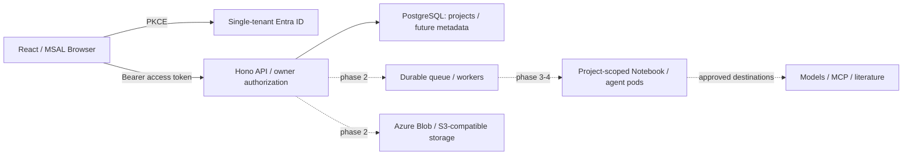

# AIRA Nexusの全体設計と今回の実装境界

開発・運用担当者向けに、確定要件と後続実装の責務を示す。
更新: 2026-11-12。正本は [SDD仕様](../.sdd/specs/)、根拠は [機能比較](../.consulting/research-workbench/decision-analysis.md)。

## 今回は認証・個人プロジェクト・画面基盤を実装する

①の範囲はEntraサインイン、所有者限定の作成・一覧・取得・改名、3ペインUI。
削除・共有・チャット実行・ファイル操作・Notebook実行は含めない。後続タブは利用不可と明記する。
分析の結論はFND-01/02に基づく。Mastra採用と中規模負荷の適合は未確定（FND-03、HYP-04）。

## コンポーネントとデータの流れ

APIは認証と所有者確認、DBは永続化と競合制御を担う。将来のワーカーがDB資格情報やクラスタ管理権限を解析Podへ渡すことは認めない。
APIがモデルを呼べることと、ユーザーがファイルへアクセスできることは別の認可である。

## Web UIはTailwindとRadix版shadcn/uiで構成する

React/TypeScript/Viteを維持し、Tailwind CSSを`@tailwindcss/vite`でビルドする。
UI部品はRadix UIベースのshadcn/ui、アイコンは`lucide-react`を使う。shadcn/uiのBase UI版とは混在させない。
①で必要なButton・Input・Label・Tabs等だけを導入し、部品のソースをリポジトリ内で管理する。独立したUIフレームワークを重ねて追加しない。
配色・余白・文字はTailwindと共通のテーマ変数で統一する。独自CSSはテーマ定義とユーティリティで表せない箇所に限定する。
Radix UIのキーボード操作・フォーカス管理を活かし、各入力とアイコン操作にアクセシブル名を付ける。
この選定は実装方針であり、現時点でTailwindやUI部品を導入済みという意味ではない。

## ①のデータ・API契約

| 操作                                    | 契約                                                             |
| --------------------------------------- | ---------------------------------------------------------------- |
| `GET /api/config`                       | 公開可能なtenant/client/scope/originだけ。秘密・DB URLは返さない |
| `GET /api/me`                           | 検証済みのtenant/object identity                                 |
| `GET /api/projects`                     | 自分のプロジェクトだけ。updated_at降順・id昇順                   |
| `POST /api/projects`                    | `{"name":"解析テーマ"}` → 201、サーバー採番、version=1           |
| `GET /api/projects/:id`                 | 所有者だけ取得。別所有者も不明IDも404                            |
| `PATCH /api/projects/:id`               | nameのみ。`If-Match: "1"`で改名しversionを増やす                 |
| `GET /health/live`, `GET /health/ready` | プロセスとDB接続を分けて確認                                     |

projectsはUUID、tenant_id、owner_oid、name、version、created_at、updated_atを保持する。
同名を許可する。名前はtrim後1〜100 Unicodeコードポイント、制御文字不可。JSON本文は16KiBまで。
改名のversion未指定428、不正400、競合409。JSONエラーは`error.code/message/requestId`形式。
不正認証401、スコープ／クライアント不一致403、キー取得障害503。サーバー内部情報は返さない。
マイグレーションはAPI起動と分け、トランザクション・advisory lock・適用済みSQLハッシュで管理する。

## 認証と秘密の境界

公開SPAはMSALのPKCEでアクセストークンを取得し、APIは固定tenantのJWKS、RS256、issuer、audience、tid/oid、exp/iat/nbf、scope、azpを検証する。
API側にはEntra client secretもユーザートークンストアも置かない。ブラウザのsessionStorageはXSSから完全には守れないため、CSPとHTML描画制限を併用する。
本番はHTTPSかつ同一origin。開発用HTTPはlocalhost/ループバックだけ許可する。CORSによる外部origin許可や開発用偽ユーザー経路は追加しない。
Entraのアプリ割当・Conditional Access・ゲスト許可は組織が設定する。単一tenant制約だけではゲストを除外できない。
認証ヘッダー・トークン・DB URLをログに含めない。request IDとエラー分類で障害を追跡する。

## 後続機能と設計の判断点

実装順と依存関係は [.sdd/implementation-plan.json](../.sdd/implementation-plan.json) のfeatureグラフを正本とする。
②はファイル・キュー・チャット、③は隔離Python/R・Notebook、④は承認制Skills/MCP・既存エージェント、⑤は文献・RAG・成果物追跡、⑥は配備と負荷検証。
Mastraは①に依存パッケージとして導入しない。④で公式MCP・Skills・SDK/ACP経路を比較し、承認と中断を強制できる接続だけ有効にする。
Claudeのclaude.aiログイン提供は事前承認を要するためAPI経路を基本とする。CopilotのユーザーOAuth／組織認証、Codexのプログラム認証は資格情報を分離して検証する。
Notebookの変数はカーネル生存中だけ保持する。Notebookと成果物は保存し、Pod喪失時の状態消失を明示する。
研究成果の追跡は科学的妥当性や再現性の保証と区別する。

## 配備・運用・検証の未確定事項

将来の共通基盤はAKS／オンプレミスKubernetes。ローカルComposeは開発用であり、可用性や複数ホストの証拠ではない。
①はPostgreSQLのみを外部永続サービスとする。TLS・秘密管理・バックアップは運用側の責務。
登録300人・同時50人・10GBは設計目安。応答時間、可用性、保持期間、RTO/RPO、費用上限は未合意であり本番保証を置かない。
規制対象／臨床データの投入、実テナント接続、実クラスタ運用は未承認・未検証。
①の検証は署名JWT、実PostgreSQLの隔離・競合、ブラウザUI、型・lint・build。実SSOと将来の研究機能は別途検証する。
